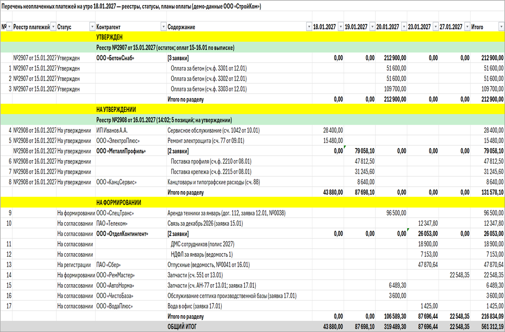
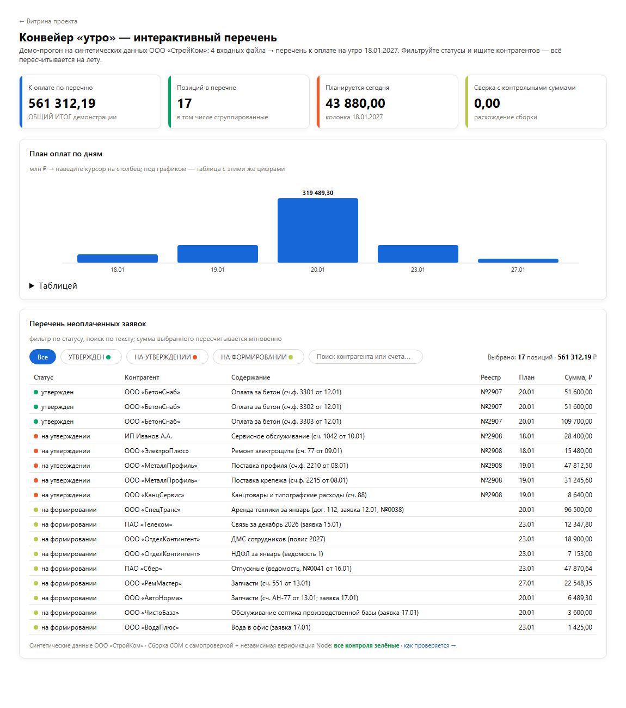
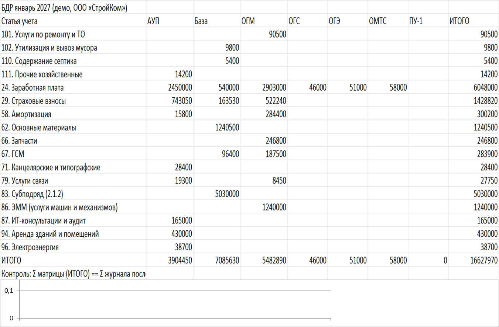
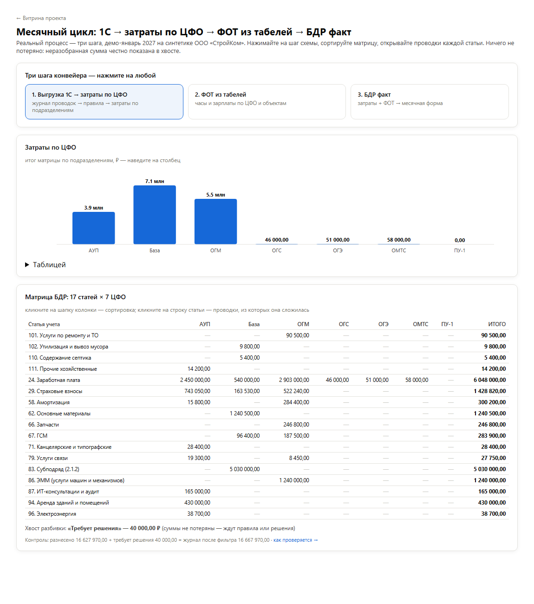
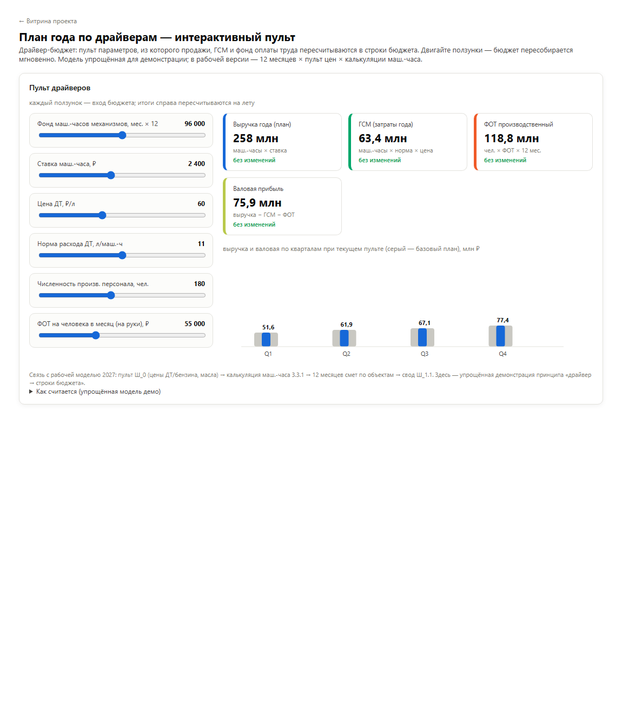
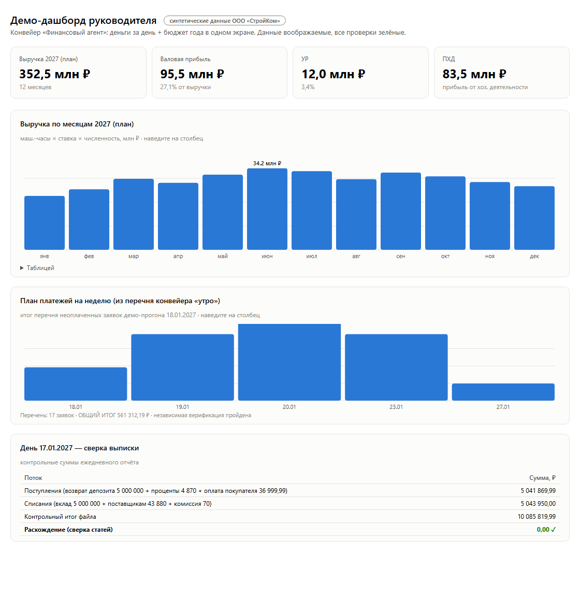

# Финансовый агент строительной компании

**Онлайн-версия (GitHub Pages):** https://sam09061978-art.github.io/financial-agent/

ИИ-агент, который из сырых выгрузок (банк, реестры платежей, 1С) за минуты собирает управленческие отчёты: перечень платежей к оплате, бюджеты доходов и расходов по подразделениям, дашборд руководителя. Каждый расчёт проходит автоматическую сверку сумм — расхождения либо ноль, либо явно видны.

## Проблема

Каждое рабочее утро финансовый блок строительной компании проходит один и тот же цикл:

- скачать выписку банка, реестры платежей, журнал заявок и выгрузку перечня из 1С;
- свести их вручную: кто не оплачен, что в реестрах на утверждении, что в formation;
- перепроверить контрольные суммы, чтобы не пропустить рубль;
- подготовить список к оплате для руководителя.

Это 1–2 часа ручной сводки в день и постоянный риск копеечной ошибки, которая потом ищется часами. Раз в месяц — то же самое в другом масштабе: бюджет доходов и расходов (БДР) по ЦФО из выгрузок 1С, а поверх него — отчётность для руководителя.

## Пользователь

- **Финансовый директор / экономист** — ежедневный перечень к оплате и monthly БДР без ручной сводки;
- **Руководитель компании** — дашборд «деньги и бюджет» к утру;
- **Коллеги и новые сотрудники** — процесс оформлен паспортом (скиллом) и воспроизводится без автора.

## Основная функция

Три сценария одного агента — два фактовых (день, месяц) и один плановый (год):

**Сценарий 1 — «Утро» (ежедневный, факт, главный):**
- Вход: банковская выписка, реестр платежей, журнал заявок, перечень неоплаченных из 1С (4 файла).
- Что делает: сверяет выписку с контрольным итогом, разносит платежи по реестрам, снимает оплаченные, добавляет новые заявки, строит итоговый перечень.
- Выход: Excel-перечень «Неоплаченные заявки» (живые формулы сумм, группировка контрагентов, статусы реестров, план платежей по дням) + отчёт дня со сводом, контрольными суммами и «требует решения».

**Сценарий 2 — «Месяц» (БДР факт по ЦФО, три шага):**
1. Выгрузка из 1С → **затраты по ЦФО**: журнал проводок раскладывается декларативными правилами (счёт+контрагент → статья, подразделение → ЦФО); регламентные переносы исключаются поимённо, непопавшее — в лист «Требует решения».
2. **ФОТ для БДР из табелей** с делением по ЦФО и объектам: пофамильные табели (часы, «сумма на руки»), начисление/НДФЛ — из 1С-ведомостей; окрашенные дни табеля относят часы к объектам.
3. **БДР факт**: затраты + ФОТ собираются в месячную форму; контроль Σ строк = источникам, квартальный свод = сумме месяцев.

**Сценарий 3 — «Год» (план на следующий год по драйверам):**
- Вход: пульт драйверов (фонд маш.-часов, ставка маш.-часа, цены топлива, нормы расхода, численность, ФОТ на человека) + калькуляция маш.-часа.
- Что делает: пересчитывает драйверы в строки бюджета — выручка, ГСМ, ФОТ, валовая — по месяцам и кварталам; изменение одного параметра перестраивает весь план.
- Выход: периодизированный файл бюджета года (12 месяцев) со сводом смет; на витрине — интерактивный пульт ([pages/plan.html](pages/plan.html)) с мгновенным пересчётом.
- Статус: принцип работает и демонстрируется; рабочая модель 2027 построена на тех же связях (пульт Ш_0 → калькуляция 3.3.1 → сметы → свод Ш_1.1), осталась замена 71 хардкодированной строки ФОТ окладами от ОТиЗ.

**Инструменты**: Claude Code (агентная обработка навыку/плану), Node.js + SheetJS для чтения/генерации данных, Microsoft Excel COM (Windows Script) для сборки Excel-артефактов с формулами и форматированием, HTML/CSS для дашбордов.

## Формат результата

- Excel-перечень платежей с формулами (суммы, итоги по реестрам, общий итог), группировками строк и выделением статусов;
- Markdown-отчёт дня: источники, сверка выписки, свод секций, контрольные равенства, «требует решения»;
- Книга БДР месяца: матрица «статья × ЦФО», лист управленческого учёта, выручка, прочие доходы/расходы;
- HTML-дашборд руководителя (открывается в браузере).


## Скриншоты

<table><tr><td width="50%">
<br>
<i>Сценарий «Утро» (факт): перечень неоплаченных заявок — статусы реестров, план оплат по дням, живые формулы</i>
</td><td width="50%">
<br>
<i>Интерактивная страница сценария: фильтры по статусам, поиск, мгновенный пересчёт выбранных сумм</i>
</td></tr><tr><td width="50%">
<br>
<i>Сценарий «Месяц» (факт): матрица «статья × ЦФО» из журнала 1С — итоги с формулами, контроль Σ = журналу</i>
</td><td width="50%">
<br>
<i>Интерактивная страница цикла: шаги процесса, затраты по ЦФО, проводки каждой статьи в один клик</i>
</td></tr><tr><td width="50%">
<br>
<i>Сценарий «Год» (план): пульт драйверов — маш.-часы, ставка, цена ДТ, численность, ФОТ пересчитывают бюджет мгновенно</i>
</td><td width="50%">
<br>
<i>Дашборд руководителя: деньги дня и бюджет года на одном экране</i>
</td></tr></table>

## Интерактивные страницы (GitHub Pages)

Витрина проекта — 5 кликабельных страниц, каждая посвящена своему блоку:

1. **Конвейер «утро»** ([pages/utro.html](pages/utro.html)) — демо-перечень живой: фильтры по статусам реестров, поиск, план оплат по дням, сумма выбранного пересчитывается мгновенно;
2. **Как артефакты доказывают правильность** ([pages/proverki.html](pages/proverki.html)) — четыре уровня контроля раскрываются по клику с фактическими контрольными числами демо-прогона;
3. **Месячный цикл БДР** ([pages/bdr.html](pages/bdr.html)) — три шага реального процесса (выгрузка 1С → затраты по ЦФО; ФОТ из табелей по ЦФО и объектам; БДР факт), затраты по ЦФО графиком, матрица 17 статей × 7 ЦФО с сортировкой и проводками каждой статьи в один клик;
4. **Дашборд руководителя** ([dashboard/index.html](dashboard/index.html)) — деньги дня и бюджет года;
5. **План года по драйверам** ([pages/plan.html](pages/plan.html)) — интерактивный пульт: двигайте фонд маш.-часов, ставку, цену ДТ, численность и ФОТ — выручка, ГСМ, фонд оплаты труда и валовая пересчитываются мгновенно по кварталам (упрощённая демонстрация принципа «драйвер → строки бюджета»; в рабочей версии — пульт Ш_0 на 12 месяцев, калькуляция маш.-часа, свод смет).

Данные страниц — синтетические (`demo/pages-data.js`), генерируются из того же набора, что и Excel-артефакты.

## Минимальный функционал (MVP)

Реализовано и стабильно работает:
1. **«Утро» (факт)** — ежедневный конвейер БДДС: более 20 рабочих дней подряд на реальных данных, расхождение с выпиской — 0;
   демонстрируется на синтетическом комплекте (`demo-data/` → `demo-output/unpaid-payments-register.xlsx`);
2. **«Месяц» (факт)** — БДР по ЦФО: выгрузка 1С → затраты по ЦФО; ФОТ из табелей (ЦФО × объекты); БДР факт — матрица «статья × ЦФО» с живыми формулами; в демо — январь 2027 (Σ = журналу после фильтра регламентных переносов, расхождение 0,00);
3. **«Год» (план)** — бюджет года по драйверам (демо-пульт с мгновенным пересчётом); рабочая модель 2027 периодизирована, пульт цен и калькуляция маш.-часа связаны;
4. Дашборд руководителя (демо-версия на вымышленных данных, открывается в браузере);
5. Скилл для воспроизводимости главного сценария коллегами ([skills/unpaid-payments-daily/SKILL.md](skills/unpaid-payments-daily/SKILL.md)) — обезличен, работает без данных компании.

В планах: полная чистка хардкодов бюджета-2027 (нужны оклады от ОТиЗ), ежемесячный анализ техники, автоматическая загрузка новых форматов выгрузок.

## Технологии

- **Node.js** + SheetJS (xlsx) — чтение/генерация Excel-выгрузок и контроль сумм;
- **Windows Script Host (JScript) + Excel COM** — сборка Excel-книг с формулами, группировкой, условным форматированием;
- **Python/статические генераторы HTML** — дашборды;
- **Claude Code skills** — воспроизводимые сценарии работы агента.

## Запуск

Подробная инструкция по шагам — в [`demo/README`](demo/README.md) (синтетический комплект данных прилагается, чтобы конвейер можно было пройти без реальных данных компании).

Быстрый сценарий (Windows, установлен Excel):

```
git clone <repository-url>
cd financial-agent
node --version            # Node.js >= 18
npm --prefix scripts install
# 1) посмотреть демо-данные
ls demo-data/
# 2) прогнать конвейер «утро» на синтетике
cscript //nologo scripts/build-register-com.wsf demo/register-data.json demo-output/unpaid-payments-register.xlsx
node scripts/verify-register.js   # независимая проверка артефакта
# 3) прогнать конвейер «месяц» (БДР) на синтетическом журнале
node scripts/make-demo-bdr-data.js
node scripts/build-bdr-demo.js
# 4) открыть итоги
start demo-output/unpaid-payments-register.xlsx
start demo-output/bdr-stroykom-01.2027.xlsx
start dashboard\index.html
```

## Как проверяется качество

Каждый артефакт прогоняется независимым верификатором: сверка с банковской выпиской, контрольные равенства «Σ статей = итог выписки», «свод = сумма секций», проверка формул в Excel-артефакте. Пример журнала проверки — `demo-output/verification-report.md`.

## Структура

```
financial-agent/
├── README.md            ← этот файл
├── index.html           ← витрина проекта (карточки, скриншоты, оглавление)
├── skills/              ← скилл главного сценария (Claude Code)
├── scripts/             ← обобщённый конвейер
├── demo-data/           ← синтетические входные данные
├── demo-output/         ← артефакты прогона на синтетике
├── dashboard/           ← демо-дашборд руководителя
└── docs/                ← отчёты, метрики, сценарий выступления
```
